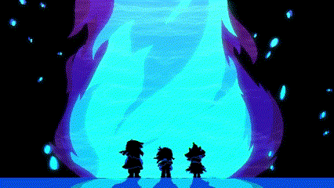
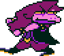
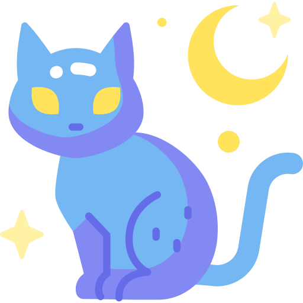
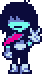
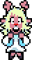
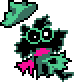
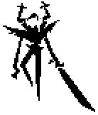

# ✦ CAROL'S DARK WORLD ✦

*Bem-vindo(a) ao meu cantinho do Dark World.*

`Estudante de Sistemas para Internet` · `Desenvolvedora em Progresso` · `Médica Veterinária`

## ♡ Sobre Mim

Olá, viajante! Eu sou a **Carol**.

Sou veterinária de formação e, atualmente, estudante de **Sistemas para Internet**, explorando o mundo da programação e da tecnologia.

Quando não estiver codando, eu provavelmente estarei lendo um livro, jogando algo ou passando um tempo com meus gatos.

 

---

## ⚔ Meu Inventário

**Tecnologias que Estudei:**

## ✧ Escolha o seu Caminho

| Rota | Interesse |
|:---:|:---|
| 🎨 | Desenvolvimento Front-end |
| 🗄️ | Back-end & Banco de Dados |
| 🔐 | Cibersegurança |

*Continuo explorando, aprendendo e encontrando o meu próprio caminho.*

---

## ♡ Fora do Dark World

 

**Livros · Jogos · Gatos**

*Três coisas que tornam o meu mundo um pouco melhor.*

---

### Obrigada por visitar meu Dark World!

*A aventura ainda está carregando...*

Algo está observando das sombras.

<!--
O CAVALHEIRO ESTÁ SE APROXIMANDO.
Mas ninguém sabe quando...
-->
